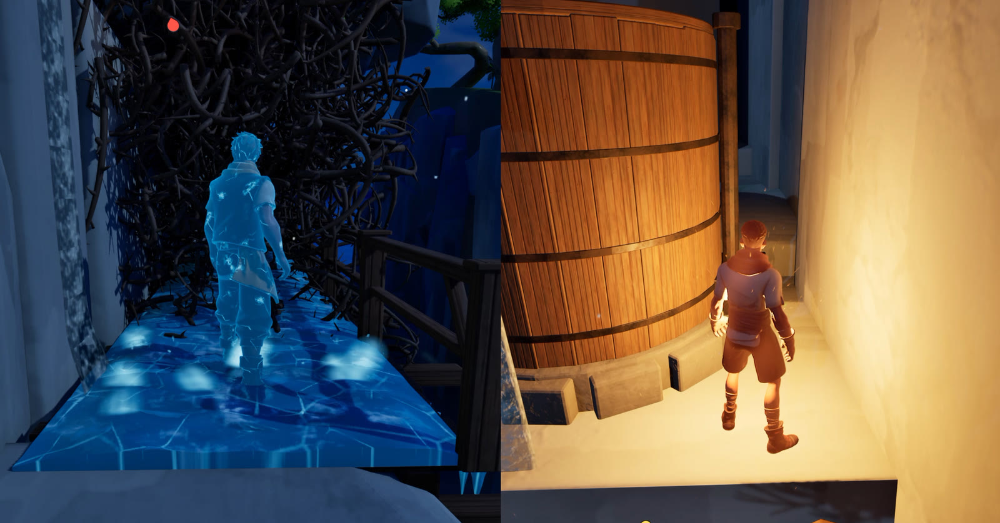

# UnrealSplit

Two-player split-screen co-op for Unreal Engine 5.8, on one couch or across two machines, with the same code path.


*[Wavelengths](#background), a co-op game built on UnrealSplit. Both players always see both halves of the screen, in couch and in online play.*

UnrealSplit gives two players a shared split screen in three connection modes: **couch** (one machine, two controllers), **LAN**, and **online** through Epic Online Services (EOS). Online, each machine still draws both players. The partner's half is rendered locally from their streamed camera, not sent as video. Your gameplay code is the same in every mode.

## Features

- **One code path for couch, LAN and online.** The mode is picked at launch with `-ConnectionMode=`; game code never branches on it.
- **Partner view over the network.** Each player's finished camera (position, rotation, field of view) is streamed at 30 Hz and replayed about 100 ms behind with interpolation, so the partner's half stays smooth under network jitter.
- **Flexible, server-authoritative layout.** Any split ratio (say 20/80), animated blends, and merging both players onto one full-screen view: player 1's camera or any camera in the level.
- **Input routing.** Assign gamepads and keyboard/mouse to local players at runtime, swap controllers, or capture the next button press to give that device to a player.
- **Sessions.** Host, find, join, leave and travel with every local player, a two-player cap, and a find-list snapshot (lobby or in progress, which slots are still free).
- **Audio listener policy.** Hear the level from your own view only, or from both views, with each sound played once from the nearer one.
- **Console commands for everything** (`US.*`), a Blueprint-callable API, and automated tests.

## Requirements

- **Unreal Engine 5.8.** That's the version UnrealSplit is developed and tested on. Other 5.x versions may need small changes.
- **Windows.** Other platforms are untested.
- **A C++ project.** The plugin ships as source.
- **Plugins:**
  - EnhancedInput, OnlineSubsystem and OnlineSubsystemUtils are enabled automatically.
  - Enable **OnlineSubsystemNull** for LAN and **OnlineSubsystemEOS** for online play.
- **For online play:** your own product on the [Epic Developer Portal](https://dev.epicgames.com/portal).
- **A conventional player camera.** See [Limitations](#limitations).

## Installation

1. Clone into your project's `Plugins` folder:
   ```
   git clone https://github.com/JI20/unreal-split.git Plugins/UnrealSplit
   ```
2. Enable OnlineSubsystemNull (and OnlineSubsystemEOS for online play) in the Plugins window or your `.uproject`.
3. Add the minimal setup below, regenerate project files and build.

## Minimal setup

Add to `Config/DefaultEngine.ini`:

```ini
[/Script/Engine.Engine]
GameViewportClientClassName=/Script/UnrealSplit.USGameViewportClient

[/Script/EngineSettings.GameMapsSettings]
bUseSplitscreen=True
TwoPlayerSplitscreenLayout=Vertical

[/Script/Engine.GameSession]
MaxPlayers=2

[OnlineSubsystem]
DefaultPlatformService=Null

[OnlineSubsystemNull]
bEnabled=true
bAddUserNumToNullId=True
```

That's enough for couch and LAN. Online play needs an EOS block too; see [Configuration](Docs/Configuration.md).

## Quick start

All of this works from the console (`` ` ``) in a Standalone Game or a Development build.

| Try | Commands |
|---|---|
| Couch co-op | `US.AddLocalPlayer`, then plug in a second gamepad |
| LAN | start two processes with `-ConnectionMode=Null`; first `US.Host`, then on the other `US.Find` and `US.Join` |
| Layout | `US.SplitRatio 0.2` · `US.Merge` · `US.Split` |
| Status | `US.SessionState` · `US.ViewState` |

The same from C++ (layout changes run on the server or in standalone):

```cpp
#include "USViewSubsystem.h"

if (UUSViewSubsystem* Views = GetGameInstance()->GetSubsystem<UUSViewSubsystem>())
{
    Views->MergeViews(1.0f, SideViewCamera);  // both players share one camera, 1 s blend
    Views->SplitViews(0.5f, 1.0f);            // back to 50/50
}
```

## Documentation

- [Configuration](Docs/Configuration.md): connection modes, LAN and EOS setup, launch flags, tunable settings
- [Console commands](Docs/ConsoleCommands.md): every `US.*` command
- [How it works](Docs/HowItWorks.md): the architecture behind the partner view, layout and sessions
- [Testing](TESTING.md): manual test protocol and automated tests

## Limitations

- **Two players.** Sessions and layout are built for exactly two.
- **Conventional cameras only.** The game must present its view through `APlayerCameraManager` (the engine default is enough) plus a `UCameraComponent` on the pawn, typically on a spring arm. UnrealSplit samples that camera for the stream.
  - Don't drive the view with the experimental **Gameplay Cameras** system (`AGameplayCamerasPlayerCameraManager`, `UGameplayCameraComponent`, camera directors/rigs). It evaluates a separate pose and often binds to player 0 only, so the stream and the second local player's half won't follow it.
  - If a project has both, turn the Gameplay Cameras path off at runtime. `US.ViewState` is the check: both halves should show the same kind of follow camera.
- **Layout changes are server-only.** There is no client request path; trigger them from server-side logic such as level volumes or puzzle code.
- **Online play has seen less use than couch.** Couch mode is the most tested; LAN and EOS work, but have had less real-world play.

## Background

UnrealSplit was built for **Wavelengths**, a two-player asymmetric co-op game about thermal physics, developed as part of a Master's thesis at the Technical University of Munich. If you use UnrealSplit in research, please cite:

> Jonas Itt. 2026. *Wavelengths: Exploring the Potential of Asymmetric Game Design for Collaborative Physics Learning.* Master's thesis. Technical University of Munich.

## License

UnrealSplit is licensed under the [Apache License 2.0](LICENSE). You can use it in free and commercial projects, modify it and redistribute it. When you distribute it, include the [LICENSE](LICENSE) and [NOTICE](NOTICE) files.

If you ship something with UnrealSplit, a mention in your credits would make my day.
